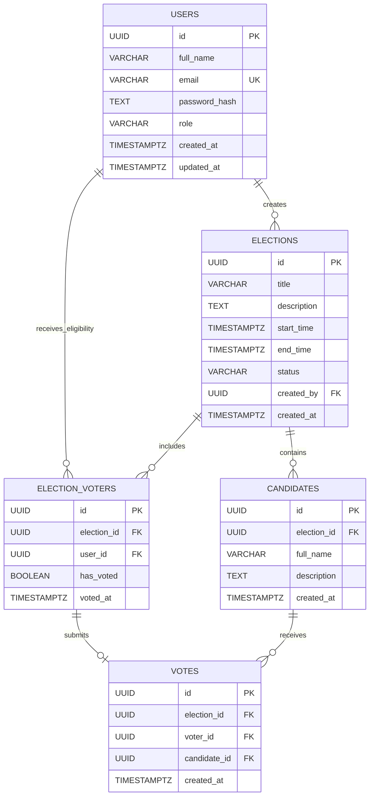

# VoteSphere – Database Entity Relationship Diagram (ERD)

**Organisation:** Veltara Technologies
**Project:** VoteSphere
**Document:** Database Entity Relationship Diagram
**Database:** PostgreSQL
**Status:** Initial Design

## 1. Overview

This document describes the relational database structure for VoteSphere, a cloud-native voting platform.

The database is designed using PostgreSQL to manage user accounts, elections, candidates, voter eligibility, and submitted votes while maintaining data integrity and preventing duplicate voting within an election.

## 2. Entity Relationship Diagram

## 3. Entity Descriptions

### 3.1 Users

Stores registered platform users, including voters and administrators.

- Primary key: `id`
- Unique email address (case-insensitive).
- Role identifies whether a user is a voter or administrator.
- Passwords are stored as secure password hashes, never plaintext.

### 3.2 Elections

Stores election details and scheduling information.

- Primary key: `id`
- `created_by` references the user who created the election.
- `start_time` and `end_time` define the election period.
- Status values: `draft`, `scheduled`, `active`, and `completed`.

### 3.3 Candidates

Stores candidates participating in individual elections.

- Primary key: `id`
- `election_id` references the associated election.
- A candidate belongs to one election.

### 3.4 Election Voters

Tracks users who are eligible to participate in specific elections.

- Primary key: `id`
- `election_id` references an election.
- `user_id` references a registered user.
- `has_voted` records whether the eligible voter has voted.
- `voted_at` records the voting timestamp.

A unique constraint on `(election_id, user_id)` prevents duplicate eligibility records.

### 3.5 Votes

Stores submitted voting records.

- Primary key: `id`
- `election_id` identifies the election.
- `voter_id` references the eligible user.
- `candidate_id` references the selected candidate.
- `created_at` records when the vote was created.

## 4. Relationships and Cardinality

| Relationship | Cardinality | Description |
|---|---|---|
| Users → Elections | One-to-many | A user can create multiple elections. |
| Users → Election Voters | One-to-many | A user can be eligible for multiple elections. |
| Elections → Election Voters | One-to-many | An election can have multiple eligible voters. |
| Elections → Candidates | One-to-many | An election can contain multiple candidates. |
| Election Voters → Votes | One-to-zero-or-one | Each eligible voter can submit at most one vote per election. |
| Candidates → Votes | One-to-many | A candidate can receive multiple votes. |

## 5. Data Integrity and Constraints

The database uses the following constraints:

1. Primary keys uniquely identify each record.
2. Foreign keys maintain relationships between entities.
3. Case-insensitive unique email indexing prevents duplicate user accounts with different email casing.
4. A unique constraint on `(election_id, user_id)` prevents duplicate voter eligibility records.
5. A unique constraint on `(election_id, voter_id)` prevents a voter from voting more than once in the same election.
6. A composite foreign key ensures that a submitted vote references an eligible voter in the same election.
7. A composite foreign key ensures that the selected candidate belongs to the same election as the vote.
8. Check constraints validate election periods, election statuses, user roles, and voting status consistency.

## 6. Indexing Strategy

The following indexes support frequently queried data:

| Index | Purpose |
|---|---|
| `users_email_unique` | Efficient case-insensitive user lookup and uniqueness. |
| `idx_candidates_election` | Retrieve candidates belonging to an election. |
| `idx_election_voters_user` | Retrieve elections associated with a user. |
| `idx_votes_election` | Retrieve votes belonging to an election. |
| `idx_votes_candidate` | Retrieve vote counts for candidates within an election. |

Unique constraints also create supporting unique indexes where applicable.

## 7. Voting Integrity

PostgreSQL is the authoritative source of truth for submitted votes.

The application and background worker must process vote submission within a database transaction.

The transaction must:

1. Verify that the voter is eligible.
2. Confirm that the voter has not already voted.
3. Confirm that the election is active and within its voting period.
4. Confirm that the selected candidate belongs to the election.
5. Insert the vote record.
6. Update the eligibility record to `has_voted = TRUE` and set `voted_at`.

If any operation fails, the transaction must roll back.

The unique constraints provide an additional database-level safeguard against duplicate submissions, including concurrent requests.

**Privacy note:** The current schema links vote records to voter identities. Therefore, this design does not provide anonymous voting.

## 8. Source SQL

The initial PostgreSQL schema is maintained at:

`database/init.sql`

This file is the implementation reference for the entities, relationships, constraints, and indexes documented above.

## 9. Design Status

This is the initial database design for VoteSphere. It should be reviewed against the PostgreSQL initialization script, validated through database testing, and approved by the engineering team before Issue #2 is closed.

---

**Organisation:** Veltara Technologies
**Project:** VoteSphere
**Document:** Database Entity Relationship Diagram
